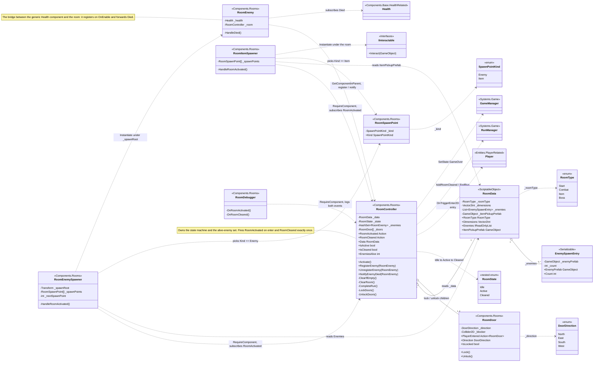
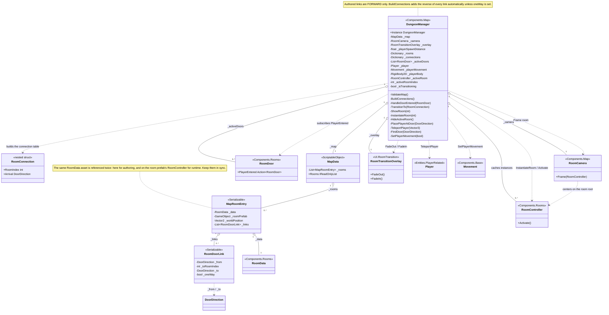
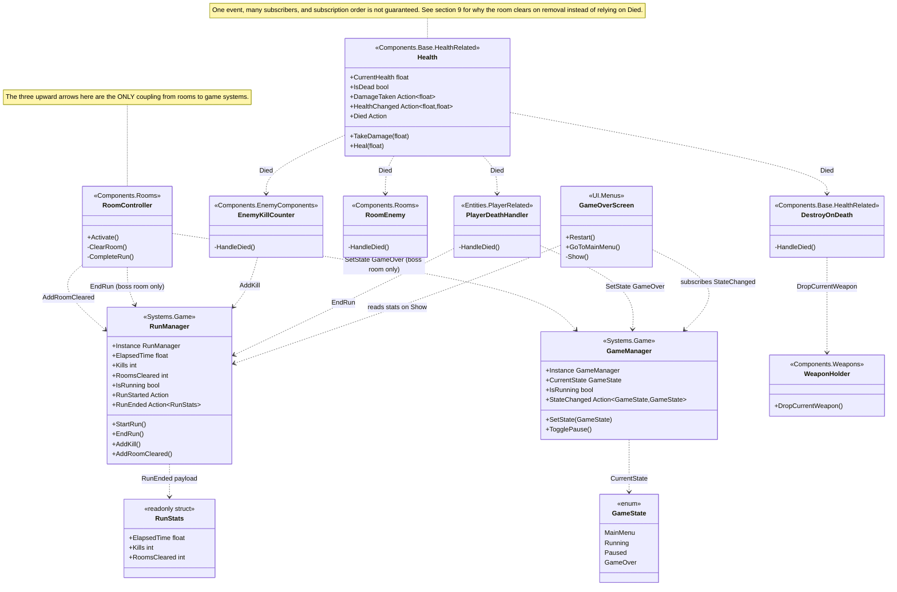
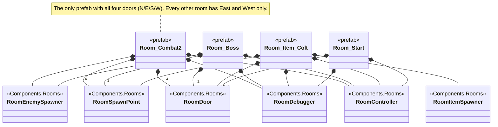
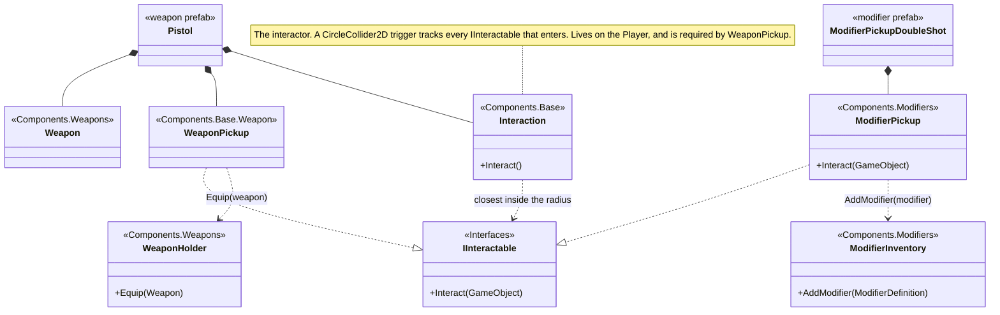
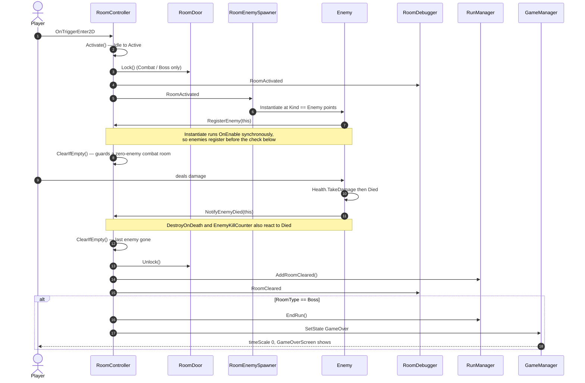
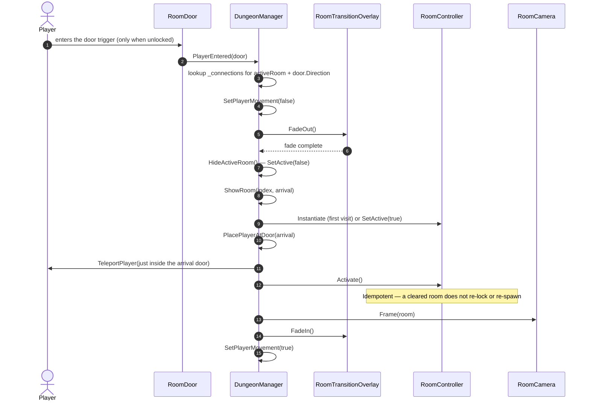

# Rooms — Class & Communication Diagram

How the room system is structured, and how rooms talk to the rest of the game.

> Companion to `ARCHITECTURE.md` §4.14. Read this when you need to change room behaviour and want
> to know what else will be affected. Everything here is verified against the source; file paths are
> given per section.

---

## Legend

| Notation | Meaning |
|----------|---------|
| `A --> B` (flowchart) | A knows about / calls B |
| `A o-- B` / `A *-- B` (class) | Aggregation (holds a reference) / composition (owns the object) |
| `A ..> B` (class) | Dependency — A uses B but does not own it (usually a call or a subscription) |
| `A ..\|> B` | A implements interface B |
| `1`, `0..*`, `1..4` | Multiplicity |
| `+Member` / `-member` | Public / private |
| `+Event Action` | A C# `event` (the primary communication mechanism in this system) |
| `<<...>>` | Stereotype — used here to show the **namespace**, or that something is a prefab / enum |

**The one rule to remember:** rooms never reference each other. All room-to-room navigation goes
through `DungeonManager`, and all room-to-game communication is either a C# event or one of three
explicit method calls.

---

## 1. Layer overview

Dependencies point **downward**. The room layer never knows about the map layer that instantiates it
(except through the `RoomController` API), and it touches the game layer at exactly three points.

```mermaid
flowchart TB
    subgraph GAME["Systems.Game · UI.Menus"]
        RM["RunManager"]
        GM["GameManager"]
        GOS["GameOverScreen"]
        SL["SceneLoader"]
    end

    subgraph MAP["Components.Map · UI.RoomTransition"]
        DM["DungeonManager"]
        MD["MapData"]
        CAM["RoomCamera"]
        RTO["RoomTransitionOverlay"]
    end

    subgraph ROOMS["Components.Rooms"]
        RCT["RoomController"]
        RD["RoomDoor"]
        RDATA["RoomData"]
        RE["RoomEnemy"]
        RES["RoomEnemySpawner"]
        RIS["RoomItemSpawner"]
        RSP["RoomSpawnPoint"]
    end

    subgraph BASE["Components.Base · EnemyComponents · Interfaces"]
        H["Health"]
        DOD["DestroyOnDeath"]
        EKC["EnemyKillCounter"]
        HOLD["WeaponHolder"]
        INT["Interaction"]
        IACT["IInteractable"]
    end

    DM --> RCT
    DM --> RD
    DM --> CAM
    DM --> RTO
    RCT --> RM
    RCT --> GM
    RE --> RCT
    RE --> H
    RES --> RE
    RIS --> IACT
    INT --> IACT
    DOD --> H
    DOD --> HOLD
    EKC --> H
    EKC --> RM
    GOS --> GM
    GOS --> RM
    GOS --> SL

    classDef game fill:#e0f2fe,stroke:#0284c7,color:#0f172a
    classDef map fill:#dcfce7,stroke:#16a34a,color:#0f172a
    classDef rooms fill:#fef3c7,stroke:#d97706,color:#0f172a
    classDef base fill:#ede9fe,stroke:#7c3aed,color:#0f172a
    class RM,GM,GOS,SL game
    class DM,MD,CAM,RTO map
    class RCT,RD,RDATA,RE,RES,RIS,RSP rooms
    class H,DOD,EKC,HOLD,INT,IACT base
```

**Reading it:** `DungeonManager` drives everything about rooms from outside. `RoomController` is the
hub inside a room. The only arrows leaving the room layer upward are `RCT --> RM` and `RCT --> GM`.

---

## 2. Room domain — `Components/Rooms/`

**Points worth noticing**

- `RoomController` is the only class that knows both "room vocabulary" (`RoomData`, `RoomDoor`) and
  game vocabulary (`RunManager`, `GameManager`).
- `RoomData` is inert data. The controller and both spawners read it; nothing writes to it at runtime.
- `RoomDebugger` exists purely to observe the two events — proof that the event surface is the
  extension point. Any new room behaviour can follow the same pattern.
- `RoomState` is a private nested enum; outside code asks `IsActive` / `IsCleared`.

---

## 3. Rooms ↔ Map — `Components/Map/`, `UI/RoomTransition/`

`DungeonManager` is the only class that creates, shows, hides, and connects rooms.

**How a room gets to exist and show up**

1. `Awake` — validates the map, builds the connection table, finds the `Player`, creates a `Rooms` root.
2. `Start` — `ShowRoom(0, null)` then teleports the player to the entry room.
3. `ShowRoom` — instantiates from the prefab on first visit (and subscribes to every `RoomDoor`'s
   `PlayerEntered`), otherwise re-activates the **cached** instance. Then `Activate()`, `Frame()`.
4. On a door crossing — `HandleDoorEntered` looks up `_connections[(activeRoomIndex, door.Direction)]`.

Because room instances are cached and only `SetActive(false)`/`true`, **room state persists** — dead
enemies stay dead, a taken pickup stays gone, a dropped weapon stays on the floor.

---

## 4. Rooms ↔ Game systems

The room layer touches the game layer at exactly three call sites (all in `RoomController`).

**Two separate run-ending paths**

| Trigger | Path |
|---------|------|
| Player dies | `Health.Died` → `PlayerDeathHandler` → `RunManager.EndRun()` + `GameManager.SetState(GameOver)` |
| Boss room cleared | `RoomController.ClearRoom()` → `CompleteRun()` → `RunManager.EndRun()` + `GameManager.SetState(GameOver)` |

Both end on the same `GameOverScreen`, which shows time / kills / rooms and offers Restart or Main
Menu. The boss path is a placeholder for the dedicated victory screen (roadmap 5.5).

---

## 5. Prefab composition

Code structure and scene structure are different things. These are the actual component sets on the
prefabs, which is why rooms can *find* their collaborators without any serialized cross-references.

### 5.1 The current map (`Assets/Data/Maps/Map_Test.asset`)

| # | Position | Data asset | Room prefab | Type | Exit |
|---|----------|-----------|-------------|------|------|
| 0 | -12, 0 | `StartRoom` | `Room_Start` | Start | East → 1 |
| 1 | 12, 0 | `ItemRoom_Colt` | `Room_Item_Colt` | Item | East → 2 |
| 2 | 36, 0 | `CombatRoom_02` | `Room_Combat2` | Combat | North → 3 |
| 3 | 60, 0 | `CombatRoom_02` | `Room_Combat2` | Combat | East → 4 |
| 4 | 84, 0 | `BossRoom` | `Room_Boss` | Boss | — (run ends) |

Rooms are 20 × 11 with walls at `x = ±9`; positions are 24 units apart, so they never overlap.

### 5.2 Room prefabs

### 5.3 A spawned enemy (`Assets/Prefabs/Enemy.prefab`)

Every one of these sits on the same GameObject.

```mermaid
classDiagram
    direction TB

    class Enemy {
        <<prefab>>
    }

    class RoomEnemy {
        <<Components.Rooms>>
    }
    class Health {
        <<Components.Base.HealthRelated>>
    }
    class DestroyOnDeath {
        <<Components.Base.HealthRelated>>
    }
    class EnemyKillCounter {
        <<Components.EnemyComponents>>
    }
    class EnemyBehavior {
        <<FSM>>
    }
    class EnemyCombat {
        <<enemy>>
    }
    class EnemyAIInput {
        <<enemy>>
    }
    class EnemyWeaponDecision {
        <<enemy>>
    }
    class EnemyTargetAssigner {
        <<enemy>>
    }
    class WeaponDetection {
        <<enemy>>
    }
    class WeaponHolder {
        <<weapons>>
    }
    class Movement {
        <<base>>
    }
    class LookDirection {
        <<base>>
    }
    class ModifierInventory {
        <<modifiers>>
    }
    class HealthAudioFeedback {
        <<feedback>>
    }
    class HealthVisualFeedback {
        <<feedback>>
    }

    Enemy *-- RoomEnemy
    Enemy *-- Health
    Enemy *-- DestroyOnDeath
    Enemy *-- EnemyKillCounter
    Enemy *-- EnemyBehavior
    Enemy *-- EnemyCombat
    Enemy *-- EnemyAIInput
    Enemy *-- EnemyWeaponDecision
    Enemy *-- EnemyTargetAssigner
    Enemy *-- WeaponDetection
    Enemy *-- WeaponHolder
    Enemy *-- Movement
    Enemy *-- LookDirection
    Enemy *-- ModifierInventory
    Enemy *-- HealthAudioFeedback
    Enemy *-- HealthVisualFeedback

    RoomEnemy ..> Health : subscribes Died
    DestroyOnDeath ..> Health : subscribes Died
    EnemyKillCounter ..> Health : subscribes Died

    note for RoomEnemy "Finds its room with GetComponentInParent of RoomController, with no serialized reference. Works because RoomEnemySpawner parents the enemy under the room's spawn root."
```

### 5.4 Pickup prefabs

An item room instantiates exactly one `RoomData.ItemPickupPrefab`, parented under the room.

`RoomData.ItemPickupPrefab` accepts either kind — a weapon prefab (`Pistol` / `Mosin` / `Katana` /
`Colt`) or a prefab carrying `ModifierPickup` / `TemporaryModifierPickup`. There is no compile-time
distinction, which is why the field is a plain `GameObject`.

---

## 6. Sequence — entering, locking, clearing

---

## 7. Sequence — crossing a door

If the target has no door matching the arrival direction, `PlacePlayerAtDoor` throws
`MissingReferenceException`. That is the usual cause of a "transition does nothing" bug: a room
prefab missing a door that the map link expects.

---

## 8. Communication matrix

| From | To | Mechanism | When |
|------|----|-----------|------|
| `Player` | `RoomController` | `OnTriggerEnter2D` (no reference kept) | Walking into the room trigger |
| `Player` | `RoomDoor` | `OnTriggerEnter2D` | Walking into a door trigger |
| `DungeonManager` | `RoomController` | `InstantiateRoom`, `Activate()` | First visit / every show |
| `DungeonManager` | `RoomDoor` | subscribes `PlayerEntered` | Room instantiation |
| `DungeonManager` | `RoomController` | `SetActive(false)` | Leaving a room |
| `DungeonManager` | `RoomCamera` | `Frame(room)` | After `Activate()` |
| `DungeonManager` | `RoomTransitionOverlay` | `FadeOut()` / `FadeIn()` | Around every swap |
| `DungeonManager` | `Player`, `Movement` | `TeleportPlayer`, `SetPlayerMovement` | Around every swap |
| `RoomDoor` | `DungeonManager` | event `PlayerEntered` | Unlocked door entered |
| `RoomController` | `RoomDoor` | `Lock()` / `Unlock()` | Activate / clear |
| `RoomController` | `RoomEnemySpawner`, `RoomItemSpawner`, `RoomDebugger` | event `RoomActivated` | Player enters |
| `RoomController` | `RoomDebugger` | event `RoomCleared` | Last enemy removed |
| `RoomController` | `RunManager` | `AddRoomCleared()` | Every clear |
| `RoomController` | `RunManager` | `EndRun()` | Boss clear only |
| `RoomController` | `GameManager` | `SetState(GameOver)` | Boss clear only |
| `RoomEnemySpawner` | `RoomEnemy` | `Instantiate` under `_spawnRoot` | On `RoomActivated` |
| `RoomItemSpawner` | pickup (`IInteractable`) | `Instantiate` under the room | On `RoomActivated` |
| `RoomEnemy` | `RoomController` | `RegisterEnemy` / `UnregisterEnemy` / `NotifyEnemyDied` | Enable / disable / death |
| `RoomEnemy` | `Health` | subscribes `Died` | `OnEnable` |
| `DestroyOnDeath` | `WeaponHolder` | `DropCurrentWeapon()` | Enemy death |
| `EnemyKillCounter` | `RunManager` | `AddKill()` | Enemy death |
| `PlayerDeathHandler` | `RunManager`, `GameManager` | `EndRun()`, `SetState(GameOver)` | Player death |
| `GameOverScreen` | `GameManager` | subscribes `StateChanged` | Panel enable |
| `GameOverScreen` | `RunManager` | reads `ElapsedTime` / `Kills` / `RoomsCleared` | Showing the panel |
| `Interaction` | `IInteractable` | `Interact(interactor)` | Player presses interact |

---

## 9. Notes & gotchas

**Rooms never reference each other.** There is no room-to-room field or event anywhere. Navigation is
only `RoomDoor` → `DungeonManager` → next room. If you need a room to influence another, add it to
`DungeonManager`, not to the rooms.

**Only forward links are authored.** `DungeonManager.BuildConnections()` adds the reverse of every
authored `RoomDoorLink`. `_oneWay` opts a link out — useful for a door that seals behind you.

**Clearing keys off removal, not `Died`.** `DestroyOnDeath` calls `Destroy(gameObject)` *during* the
`Health.Died` event. That immediately runs `RoomEnemy.OnDisable` → `UnregisterEnemy` and nulls
`RoomEnemy._room`, so a handler registered later in the same event can be neutered. Because
`ClearIfEmpty()` runs from **both** `UnregisterEnemy` and `NotifyEnemyDied`, the room clears
correctly regardless of subscriber order. This is the fix for the historical "doors stay locked after
killing everything" bug, and it is why the room does not depend on `RoomEnemy.HandleDied` firing.

**The empty-combat-room guard.** `Activate()` calls `ClearIfEmpty()` *after* firing `RoomActivated`,
guarded by `RequiresCombat`. That prevents a Combat or Boss room with zero enemies from locking
forever, while never spuriously clearing a Start or Item room.

**`Activate()` must stay idempotent.** Cached rooms are re-activated on every re-entry. It early-returns
unless the state is `Idle`, so a cleared room never re-locks and spawners never re-spawn.

**Instantiation order matters.** `Instantiate` runs `Awake`/`OnEnable` synchronously, so enemies
register with the room during `RoomActivated` — before the subsequent `ClearIfEmpty()`.

**`RoomData` is referenced twice.** Once by `MapRoomEntry._data` (authoring) and once on the prefab's
`RoomController._data` (runtime). Runtime behaviour follows the **prefab's** reference; a mismatch
between the two is easy to miss.

**Boss = end of run.** `RoomController.CompleteRun()` reuses the Game Over screen (roadmap 5.5 covers
a dedicated victory screen). If the map ever gains more than one Boss room, this trigger needs to
become "the final room" rather than "any Boss room".

**Enemy prefab `m_EditorClassIdentifier` strings are stale hints.** They still read
`Assembly-CSharp::ModifierController`; the class was renamed to `ModifierInventory`. Binding is by
GUID, so nothing is broken — but do not trust that string as documentation.
